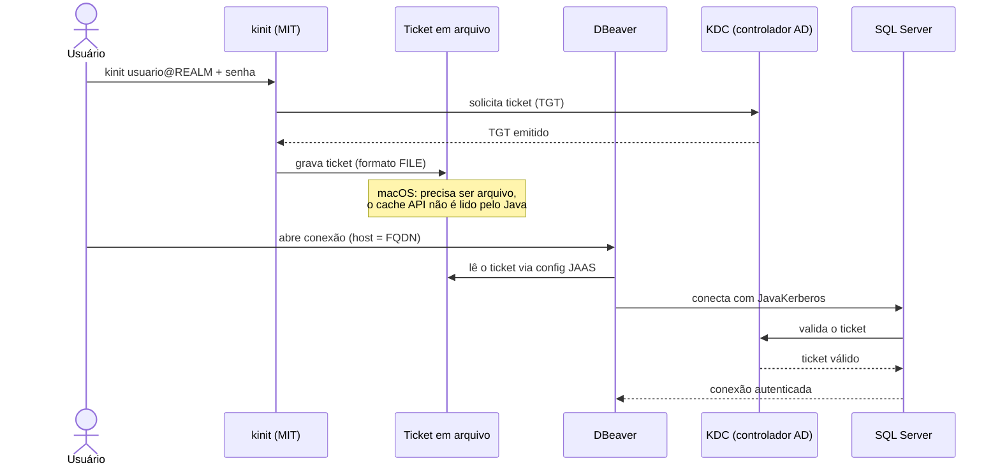

Conectar a um SQL Server que autentica via Active Directory parece trivial no Windows, onde tudo acontece de forma transparente. No macOS a história é diferente: o DBeaver não pega o login de domínio sozinho, e os erros que aparecem no caminho são pouco descritivos. Este guia documenta um procedimento que funciona de ponta a ponta, explicando o porquê de cada passo, não só o comando.

## O cenário

Um SQL Server autenticando contra um Active Directory, acessado a partir de um Mac. O servidor pode estar em qualquer lugar (on-premises, Azure, AWS), porque isso não importa para o login.

Vale começar desfazendo uma confusão comum: o lugar onde o banco roda e o provedor de identidade que valida o login são camadas independentes. Um SQL Server numa instância de nuvem pode perfeitamente autenticar contra um Active Directory tradicional via Kerberos. O que determina o método de autenticação é como o SQL Server foi configurado para confiar num domínio, não a infraestrutura onde ele está hospedado. Então "está na nuvem" não quer dizer "não é Kerberos".

Se o seu login é uma conta de domínio (`usuario@DOMINIO`) e funciona no Windows com Windows Authentication, você está no cenário deste guia: Kerberos contra Active Directory.

## Por que o macOS complica

Dois detalhes específicos do macOS atrapalham, e entender os dois evita horas de tentativa e erro.

**O cache de credenciais Kerberos.** O macOS vem com a implementação Heimdal do Kerberos. Por padrão, ela armazena o ticket num cache de credenciais do tipo `API:` (um cache em memória gerenciado pelo sistema). O problema: o Java empacotado no DBeaver não consegue ler esse formato. Resultado, o DBeaver conecta ao banco mas envia uma credencial vazia. É preciso gerar o ticket em um arquivo (cache do tipo `FILE:`), e a implementação nativa da Apple ignora a variável que pediria isso. A saída é usar a implementação do MIT Kerberos, que respeita a variável e grava em arquivo.

**A configuração JAAS.** O driver JDBC da Microsoft, ao autenticar via Kerberos, usa o JAAS (Java Authentication and Authorization Service) para obter a credencial. Por padrão ele não sabe que deve ler o ticket de um arquivo de cache. É preciso fornecer um arquivo de configuração JAAS dizendo exatamente isso, e com o nome de bloco que o driver procura.

Resolvidos esses dois pontos, o resto é configuração de conexão comum.



## Pré-requisitos

- Acesso de rede ao Active Directory e ao SQL Server. Se você acessa via VPN ou um cliente ZTNA, ele precisa estar ativo e tunelando o DNS interno do domínio, além de liberar as portas do AD (88 para Kerberos, 389 para LDAP, 53 para DNS) e do SQL Server (1433, ou a porta usada). Se um `nslookup` de um host interno do domínio retorna `NXDOMAIN`, o túnel não está encaminhando o DNS interno e nada vai funcionar até resolver isso.
- DBeaver instalado.
- Homebrew instalado.
- Os comandos abaixo assumem Mac Apple Silicon, onde o Homebrew instala em `/opt/homebrew`. Em Mac Intel, troque `/opt/homebrew/opt/krb5/bin` por `/usr/local/opt/krb5/bin`.

Ao longo do guia, use estes valores de exemplo substituindo pelos seus:

- Realm Kerberos: `EXEMPLO.COM` (sempre em maiúsculas)
- Controladores de domínio: `dc01.exemplo.com`, `dc02.exemplo.com`
- Usuário: `seu.usuario`
- Host do SQL Server: `sqlserver.exemplo.com`

### Descobrindo realm e controladores

Se você não sabe o nome do realm nem os controladores de domínio, e está com o acesso de rede ativo, este comando lista os KDCs do domínio via registro SRV do DNS:

```bash
nslookup -type=SRV _kerberos._tcp.exemplo.com
```

Atenção: o domínio interno do Active Directory frequentemente é diferente do domínio público (do site, do e-mail). O AD pode estar em algo como `corp.exemplo.com`, `ad.exemplo.local`, etc. Na dúvida, confirme com a equipe de infraestrutura, ou inspecione qual domínio de busca seu sistema enxerga com o acesso ativo:

```bash
scutil --dns | grep -i domain
```

## Passo 1 — Configurar o Kerberos (`/etc/krb5.conf`)

Crie ou edite `/etc/krb5.conf`:

```conf
[libdefaults]
    default_realm = EXEMPLO.COM
    udp_preference_limit = 1
    dns_lookup_kdc = false

[realms]
    EXEMPLO.COM = {
        kdc = dc01.exemplo.com
        kdc = dc02.exemplo.com
        admin_server = dc01.exemplo.com
    }

[domain_realm]
    .exemplo.com = EXEMPLO.COM
    exemplo.com = EXEMPLO.COM
```

O que cada parte faz:

- **`default_realm`** define o domínio Kerberos padrão. Deve ficar em maiúsculas — Kerberos é case-sensitive no realm.
- **Múltiplos `kdc`** funcionam como redundância. O cliente tenta na ordem listada e passa para o próximo se um controlador não responder. Liste mais de um se o domínio tiver vários controladores.
- **`kdc`** é o endereço do Key Distribution Center, que em Active Directory roda dentro do controlador de domínio. É o serviço que emite os tickets Kerberos.
- **`admin_server`** é o serviço de administração do Kerberos (`kadmind`). Em ambiente AD você praticamente nunca o usa a partir do cliente, porque a administração é feita pelas ferramentas da Microsoft. Ele está aqui só porque o formato espera o campo, e costuma apontar para o mesmo host do `kdc`.
- **`udp_preference_limit = 1`** força o Kerberos a usar TCP em vez de UDP. Isso resolve um problema frequente quando o tráfego passa por túneis VPN ou ZTNA, que nem sempre lidam bem com o UDP do Kerberos na porta 88.
- **`dns_lookup_kdc = false`** faz o cliente usar exclusivamente os KDCs que você listou, em vez de tentar descobri-los via registros SRV do DNS. Torna o comportamento previsível. Se preferir que o Kerberos descubra os controladores automaticamente via DNS, omita esta linha.
- **`[domain_realm]`** mapeia nomes DNS para o realm Kerberos. A entrada com ponto (`.exemplo.com`) cobre todos os hosts dentro do domínio; a sem ponto cobre o domínio raiz exato. Isso garante que, ao montar o SPN do SQL Server, o cliente saiba a que realm aquele host pertence.

## Passo 2 — Instalar o MIT Kerberos

A implementação nativa da Apple ignora a variável `KRB5CCNAME` e grava o ticket sempre no cache `API:`, que o Java do DBeaver não lê. O MIT Kerberos respeita a variável e grava em arquivo.

```bash
brew install krb5
```

No Apple Silicon, os binários ficam em `/opt/homebrew/opt/krb5/bin/`. O Homebrew não os coloca no PATH por padrão (para não sobrepor os comandos do sistema), por isso vamos chamá-los pelo caminho completo.

## Passo 3 — Gerar o ticket em arquivo

Use o `kinit` do MIT, definindo `KRB5CCNAME` para apontar o cache a um arquivo:

```bash
KRB5CCNAME=/tmp/krb5cc_dbeaver /opt/homebrew/opt/krb5/bin/kinit seu.usuario@EXEMPLO.COM
```

Digite a senha quando solicitado. Confirme que o ticket foi para o arquivo, repetindo a variável no `klist` (sem ela, o `klist` olha para outro cache):

```bash
KRB5CCNAME=/tmp/krb5cc_dbeaver /opt/homebrew/opt/krb5/bin/klist
```

A saída deve mostrar o TGT (`krbtgt/EXEMPLO.COM@EXEMPLO.COM`), a validade do ticket, e o cache identificado como `FILE:/tmp/krb5cc_dbeaver`. Confirme também que o arquivo existe:

```bash
ls -la /tmp/krb5cc_dbeaver
```

Se o `kinit` do MIT reclamar que não encontra o realm ou os KDCs, ele pode estar lendo um `krb5.conf` em outro caminho. Aponte explicitamente:

```bash
KRB5_CONFIG=/etc/krb5.conf KRB5CCNAME=/tmp/krb5cc_dbeaver /opt/homebrew/opt/krb5/bin/kinit seu.usuario@EXEMPLO.COM
```

Repare nas duas variáveis distintas: `KRB5_CONFIG` aponta para o arquivo de configuração, `KRB5CCNAME` aponta para o cache de credenciais.

## Passo 4 — Criar a configuração JAAS

O driver JDBC da Microsoft procura, por padrão, por um bloco de login JAAS chamado `SQLJDBCDriver`. Crie o arquivo:

```bash
cat > /tmp/jaas_dbeaver.conf << 'EOF'
SQLJDBCDriver {
    com.sun.security.auth.module.Krb5LoginModule required
    useTicketCache=true
    ticketCache="/tmp/krb5cc_dbeaver"
    doNotPrompt=true
    debug=true;
};
EOF
```

O que cada opção faz:

- **`useTicketCache=true`** diz para usar um cache de credenciais já existente, em vez de pedir senha de novo.
- **`ticketCache`** aponta para o arquivo gerado no passo anterior.
- **`doNotPrompt=true`** impede o módulo de tentar pedir senha interativamente (o que quebraria numa aplicação gráfica).
- **`debug=true`** imprime no console o que está acontecendo durante a autenticação Kerberos. Mantenha durante o diagnóstico e remova depois que estiver funcionando.

O nome do bloco (`SQLJDBCDriver`) precisa ser exatamente esse — é o nome que o driver da Microsoft procura. Se estiver diferente, o driver acusa que não há módulo de login configurado.

## Passo 5 — Configurar o `dbeaver.ini`

O DBeaver usa um JRE próprio empacotado, então as opções de JVM precisam ser passadas pelo arquivo `dbeaver.ini`, e essas opções têm que vir **depois** da linha `-vmargs`. Qualquer coisa antes do `-vmargs` é argumento do launcher e ignora opções de JVM.

No macOS, o arquivo fica dentro do bundle do aplicativo:

```bash
/Applications/DBeaver.app/Contents/Eclipse/dbeaver.ini
```

(Pela interface: Finder → Aplicativos → clique direito no DBeaver → Show Package Contents → `Contents/Eclipse/dbeaver.ini`.)

Adicione estas quatro linhas ao final, cada uma na sua própria linha:

```bash
-Djava.security.krb5.conf=/etc/krb5.conf
-Djavax.security.auth.useSubjectCredsOnly=false
-DKRB5CCNAME=/tmp/krb5cc_dbeaver
-Djava.security.auth.login.config=/tmp/jaas_dbeaver.conf
```

O que cada uma faz:

- **`java.security.krb5.conf`** indica ao Java qual arquivo de configuração Kerberos usar.
- **`javax.security.auth.useSubjectCredsOnly=false`** permite ao Java buscar a credencial no cache de tickets, em vez de exigir que ela já esteja no Subject corrente. Sem isso, a autenticação falha mesmo com o ticket válido.
- **`KRB5CCNAME`** aponta o cache de credenciais para o arquivo.
- **`java.security.auth.login.config`** aponta para o arquivo JAAS criado no passo 4.

Uma armadilha frequente: o `dbeaver.ini` pode não terminar com uma quebra de linha. Se você adicionar a última opção com um simples append, ela gruda na linha anterior e ambas viram lixo ignorado pela JVM. Para evitar, adicione via terminal forçando a quebra:

```bash
printf '\n-Djava.security.auth.login.config=/tmp/jaas_dbeaver.conf\n' >> /Applications/DBeaver.app/Contents/Eclipse/dbeaver.ini
```

Confira que cada opção ficou isolada em sua linha. O `cat -A` mostra os fins de linha como `$`, útil para detectar opções grudadas:

```bash
cat -A /Applications/DBeaver.app/Contents/Eclipse/dbeaver.ini | tail -6
```

## Passo 6 — Reiniciar e conectar

Encerre o DBeaver por completo. Fechar a janela não basta; o processo precisa morrer para reler o `.ini`:

```bash
pkill -9 -f dbeaver
```

Durante o diagnóstico, abra o DBeaver pelo terminal em vez do Finder. Assim as mensagens de debug do Kerberos (por causa do `debug=true` no JAAS) aparecem no terminal:

```bash
/Applications/DBeaver.app/Contents/MacOS/dbeaver
```

Na configuração da conexão SQL Server:

- **Host:** `sqlserver.exemplo.com` — sempre o FQDN, nunca o IP (explicação abaixo)
- **Porta:** `1433` (ou a porta usada)
- **Authentication:** se houver opção "Kerberos" no dropdown, selecione-a. Algumas versões do DBeaver não têm essa opção; nesse caso deixe "SQL Server Authentication" e deixe usuário e senha **em branco**, pois a autenticação será forçada pelas propriedades do driver.
- **Driver properties:**

```properties
authenticationScheme    = JavaKerberos
integratedSecurity      = true
encrypt                 = true
trustServerCertificate  = true
```

São `integratedSecurity=true` e `authenticationScheme=JavaKerberos` que fazem o driver ignorar usuário/senha e usar o ticket Kerberos. `encrypt=true` e `trustServerCertificate=true` lidam com a criptografia da conexão; ajuste `trustServerCertificate` conforme a política de certificados do seu ambiente (em produção, idealmente, valida-se o certificado em vez de confiar cegamente).

### Por que FQDN e não IP

Esse ponto merece atenção porque é causa frequente de falha. No Kerberos, o cliente não envia usuário e senha ao SQL Server; ele pede ao KDC um ticket para um identificador do serviço, o SPN (Service Principal Name), com o formato:

```bash
MSSQLSvc/sqlserver.exemplo.com:1433
```

Esse SPN foi registrado no Active Directory, quando o SQL entrou no domínio, usando o **nome** do servidor — nunca o IP. Se você informar o IP no Host, o driver tenta montar `MSSQLSvc/10.x.x.x:1433`, um SPN que não existe no AD, e o KDC responde que não conhece o serviço (erro do tipo "Server not found in Kerberos database"). Por isso o Host precisa ser o FQDN. Se você só conhece o IP, descubra o nome com uma busca reversa: `nslookup <ip>`.

## Uso no dia a dia

O ticket Kerberos expira (tipicamente em torno de 10 horas, conforme a política do domínio). Ao expirar, renove com o comando do passo 3. Para não digitar o comando longo toda vez, crie um alias no `~/.zshrc`:

```bash
alias kinit-db='KRB5CCNAME=/tmp/krb5cc_dbeaver /opt/homebrew/opt/krb5/bin/kinit seu.usuario@EXEMPLO.COM'
```

Depois é só rodar `kinit-db` antes de conectar.

Se quiser remover o ruído do debug depois que tudo funcionar, edite `/tmp/jaas_dbeaver.conf` e troque `debug=true` por `debug=false` (ou remova a linha).

## Diagnóstico de erros

Os erros do driver são pouco descritivos, mas cada um aponta para uma etapa específica.

**`Login failed for user ''`** (usuário vazio)
A conexão de rede chegou ao SQL, mas nenhuma credencial Kerberos foi enviada. Quase sempre o Java não está lendo o ticket. Verifique: o ticket foi gerado em arquivo com o `kinit` do MIT (e não no cache `API:` nativo)? As opções no `dbeaver.ini` estão depois do `-vmargs` e cada uma em sua linha? O DBeaver foi reiniciado de fato (`pkill -9 -f dbeaver`)?

**`No LoginModules configured for SQLJDBCDriver`**
Boa notícia parcial: o driver está de fato tentando Kerberos. Ele só não encontrou o bloco JAAS. Verifique: o arquivo `/tmp/jaas_dbeaver.conf` existe e o bloco se chama exatamente `SQLJDBCDriver`? A linha `-Djava.security.auth.login.config=...` foi aplicada no `dbeaver.ini` sem grudar na anterior?

**`Server not found in Kerberos database`**
O SPN do serviço não foi encontrado. Causas típicas: uso de IP em vez de FQDN no Host, ou o SPN do SQL Server não está registrado no AD (nesse caso, é tarefa da equipe que administra o domínio registrar o SPN `MSSQLSvc/host:porta` para a conta de serviço do SQL).

**`kinit` dá timeout**
Não há rota até o KDC. Confirme que a VPN ou o cliente ZTNA está ativo e tunelando. Teste a resolução e a porta:

```bash
nslookup dc01.exemplo.com
nc -vz dc01.exemplo.com 88
```

Se o `nc` conectar na porta 88, o caminho até o KDC está aberto.

**`nslookup` retorna `NXDOMAIN` para hosts internos**
O DNS interno do domínio não está sendo consultado. Seu sistema está caindo no DNS local em vez do DNS do domínio. Confirme que o túnel (VPN/ZTNA) está encaminhando as consultas internas e que o domínio que você está consultando é o domínio real do AD (que pode diferir do domínio público). Verifique o que o sistema enxerga com `scutil --dns`.

## Resumo do fluxo

1. `/etc/krb5.conf` com realm, KDCs e mapeamento de domínio.
2. MIT Kerberos instalado via Homebrew.
3. Ticket gerado em arquivo (`KRB5CCNAME` + `kinit` do MIT).
4. Arquivo JAAS com o bloco `SQLJDBCDriver` apontando para o ticket.
5. `dbeaver.ini` com as quatro opções de JVM, depois do `-vmargs`.
6. DBeaver reiniciado; conexão com FQDN no Host, usuário/senha em branco e as propriedades Kerberos no driver.

A causa raiz de tudo, que torna o macOS diferente do Windows aqui, são dois detalhes: o cache de ticket precisa estar em arquivo para o Java ler, e o driver precisa de um JAAS apontando para esse arquivo. Resolvidos esses dois, o login de domínio passa a funcionar como no Windows.
