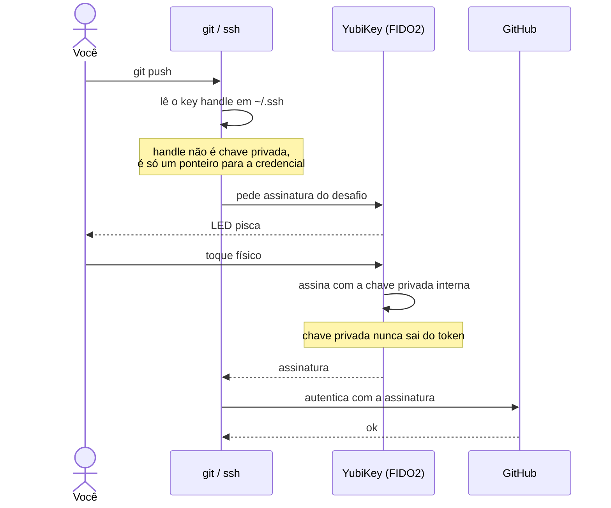

Chave SSH em arquivo no disco é um segredo copiável. Qualquer processo rodando com seu usuário consegue ler `~/.ssh/id_ed25519`, e a partir daí faz push no seu nome em qualquer repositório onde você tem acesso. Backup do disco, sincronização acidental para a nuvem, malware — em todos esses casos o segredo sai da máquina sem você perceber.

Uma YubiKey resolve isso de forma diferente de como se costuma imaginar. Ela não guarda o arquivo da chave em um cofre: a chave privada é **gerada dentro do token e nunca sai de lá**. O que fica no seu disco é apenas uma referência. Sem o dispositivo físico plugado, esse arquivo não serve para nada.

Este guia configura uma única chave que faz as duas coisas — autenticação (clone e push) e assinatura de commits — usando FIDO2 puro. Sem GPG, sem agente de smartcard, sem PIN digitado no teclado. Só o toque no sensor.

Substitua `voce@exemplo.com` pelo seu e-mail verificado no GitHub em todos os comandos.

## Por que FIDO2 e não GPG

O caminho tradicional para commits assinados é GPG, e há muito material sobre usar a applet OpenPGP da YubiKey para isso. Funciona, mas traz uma pilha considerável: `gpg-agent`, encaminhamento de socket, `pinentry`, chaveiro de confiança, sub-chaves, expiração, e o eterno "por que o agente parou de responder".

O Git 2.34 trouxe uma alternativa: `gpg.format ssh`. A partir dele, o Git assina commits com uma chave SSH em vez de uma chave GPG. Como a YubiKey já sabe ser uma chave SSH via FIDO2 (o tipo `ed25519-sk`), a mesma chave serve para autenticar e para assinar. Uma chave, um registro, zero daemons.

A troca é que você perde algumas coisas que só o GPG faz: cadeia de confiança entre pessoas, criptografia de arquivos, revogação distribuída. Para o caso de uso "quero que meus commits apareçam como verificados no GitHub e meu push exija presença física", nada disso é necessário.



## Pré-requisitos

- YubiKey 5 com firmware 5.2.3 ou superior — antes disso a applet FIDO2 não faz Ed25519
- macOS com Homebrew
- Git 2.34 ou superior, para assinatura via SSH

O firmware é gravado de fábrica e não é atualizável. Se o seu estiver abaixo de 5.2.3, dá para seguir o guia trocando `ed25519-sk` por `ecdsa-sk` em todos os comandos. A verificação vem no fim do passo 1, porque a ferramenta que reporta a versão é instalada lá.

## 1. Instalação

Aqui está a primeira pedra no caminho: o OpenSSH que a Apple distribui no macOS **não inclui o middleware FIDO2**. O `ssh-keygen -t ed25519-sk` simplesmente falha, com uma mensagem que não explica o motivo. É preciso usar o build do Homebrew.

```bash
brew install openssh libfido2 ykman gh
echo 'export PATH="/opt/homebrew/bin:$PATH"' >> ~/.zshrc
exec zsh
```

Em Macs Intel o prefixo do Homebrew é `/usr/local/bin` em vez de `/opt/homebrew/bin`.

O que cada pacote faz aqui: `openssh` é o build com suporte a FIDO2, `libfido2` é a biblioteca que conversa com o token via USB, `ykman` é a CLI de gerenciamento da YubiKey (usada no passo 2 e no diagnóstico) e `gh` é a CLI do GitHub, opcional mas conveniente para registrar as chaves sem abrir o navegador.

Confirme que o binário certo está sendo resolvido:

```bash
which -a ssh ssh-keygen
ssh -V
```

O caminho do Homebrew precisa aparecer **antes** de `/usr/bin`, e a versão não deve mencionar "Apple". Se mencionar, o PATH não foi aplicado nesta sessão do shell.

Com o `ykman` disponível, confira o firmware do dispositivo:

```bash
ykman info
```

Se a versão for menor que 5.2.3, use `ecdsa-sk` no lugar de `ed25519-sk` daqui para frente.

Para quem prefere interface gráfica, o [Yubico Authenticator](https://www.yubico.com/products/yubico-authenticator/) (versão 7 ou superior) faz as mesmas operações do `ykman` e é útil para visualizar o que está armazenado no dispositivo. Os comandos deste guia assumem a CLI.

## 2. Preparando um YubiKey novo

Se o dispositivo acabou de sair da caixa, vale gastar dez minutos endurecendo a configuração **antes** de gerar qualquer chave. As credenciais de fábrica são públicas e documentadas.

Se a sua YubiKey já está em uso e configurada, pule para o passo 3.

### Troque as credenciais padrão

O YubiKey tem PINs independentes por applet. Os que importam aqui são dois.

**PIN do FIDO2** — é o que sites como GitHub, Google e AWS pedem quando você usa passkeys. Ele é definido no momento em que você cadastra a primeira passkey, ou pelo app de gerenciamento. Não confunda com o PIN do PIV.

**Applet PIV (smart card)** — só relevante se você for usar certificados ou SSH via PIV. As três credenciais de fábrica precisam ser trocadas:

```bash
ykman piv access change-management-key --generate --protect
ykman piv access change-puk
ykman piv access change-pin
```

A Management Key de fábrica é uma constante conhecida; `--generate --protect` gera uma nova e a guarda protegida pelo PIN, então você não precisa memorizá-la. O PUK padrão é `12345678` e o PIN padrão é `123456`.

Este guia usa FIDO2, não PIV — se você não pretende usar PIV, tecnicamente pode pular esses três comandos. Mas deixar as credenciais de fábrica em um applet que você não usa também não é ideal: alguém com acesso físico ao dispositivo poderia provisionar certificados ali.

### Reduza a superfície de ataque

Desative o Yubico OTP. É o protocolo antigo, em que o toque no sensor digita uma string de 44 caracteres onde estiver o cursor. Se você não usa, ele só serve para produzir texto aleatório dentro do seu editor quando você toca na chave sem querer:

```bash
ykman config usb --disable OTP
ykman config nfc --disable OTP
```

Se você nunca vai aproximar a chave de um celular, desativar o NFC por completo elimina a possibilidade de uso por proximidade sem que você perceba.

## 3. Geração da chave

```bash
ssh-keygen -t ed25519-sk \
  -O resident \
  -O application=ssh:github \
  -C "voce@exemplo.com" \
  -f ~/.ssh/id_ed25519_sk_github \
  -N ""
```

Toque na YubiKey quando o LED piscar.

O que cada opção faz:

| Opção | Efeito |
|---|---|
| `-O resident` | A credencial fica armazenada dentro da YubiKey, permitindo recuperá-la em uma máquina nova com `ssh-keygen -K`. Consome um slot (a YubiKey 5 tem cerca de 25) |
| `-O application=ssh:github` | Rótulo da credencial no token. Precisa começar com `ssh:`. É o que aparece em `ykman fido credentials list` |
| `-N ""` | Sem passphrase no arquivo de handle |

Uma opção que **não** está aí, de propósito: `-O verify-required`. Ela exige o PIN a cada operação e, em várias combinações de firmware e libfido2, quebra a assinatura `ed25519-sk` com o erro `Couldn't sign message: invalid format`. Se você quer PIN como segundo fator mesmo assim, use `ecdsa-sk`, que não sofre desse problema.

Vale repetir, porque é o ponto que mais confunde: o arquivo `~/.ssh/id_ed25519_sk_github` **não é uma chave privada**. É um *key handle* — um ponteiro para a credencial dentro do token. Vazá-lo não expõe nada.

Teste a assinatura antes de seguir adiante:

```bash
echo teste | ssh-keygen -Y sign -f ~/.ssh/id_ed25519_sk_github -n teste
```

Deve pedir toque e imprimir um bloco `BEGIN SSH SIGNATURE`. Se falhar aqui, resolva antes de continuar — a seção de [diagnóstico](#10-diagnóstico-de-erros) cobre os casos comuns.

## 4. Registro no GitHub

Um detalhe que passa batido: a mesma chave pública precisa ser registrada **duas vezes**, com tipos diferentes. O GitHub trata autenticação e assinatura como capacidades separadas. Registrada só como `Authentication`, seus commits ficam "Unverified"; registrada só como `Signing`, o push é recusado.

```bash
pbcopy < ~/.ssh/id_ed25519_sk_github.pub
```

Em https://github.com/settings/keys:

1. **New SSH key** → Key type: **Authentication Key** → cole → Add
2. **New SSH key** → Key type: **Signing Key** → cole a mesma → Add

Ou pela CLI:

```bash
gh auth login
gh ssh-key add ~/.ssh/id_ed25519_sk_github.pub --type authentication --title "YubiKey"
gh ssh-key add ~/.ssh/id_ed25519_sk_github.pub --type signing        --title "YubiKey signing"
gh ssh-key list
```

## 5. Configuração do SSH

Em `~/.ssh/config`:

```
Host github.com
  User git
  IdentityFile ~/.ssh/id_ed25519_sk_github
  IdentitiesOnly yes
```

O `IdentitiesOnly yes` não é enfeite. Sem ele, o ssh oferece ao servidor todas as chaves que encontrar no diretório e no agente, uma por uma. Se você tem várias, o GitHub corta a conexão por excesso de tentativas antes de chegar na certa, e o erro que aparece é um genérico `Too many authentication failures`.

Opcionalmente, force SSH mesmo em remotes que já estão em HTTPS:

```bash
git config --global url."git@github.com:".insteadOf "https://github.com/"
```

## 6. Assinatura de commits

```bash
git config --global gpg.format ssh
git config --global user.signingkey ~/.ssh/id_ed25519_sk_github.pub
git config --global commit.gpgsign true
git config --global tag.gpgsign true
git config --global gpg.ssh.allowedSignersFile ~/.ssh/allowed_signers

printf '%s %s\n' "voce@exemplo.com" "$(cat ~/.ssh/id_ed25519_sk_github.pub)" > ~/.ssh/allowed_signers
```

Note que `user.signingkey` aponta para a chave **pública**. Isso parece errado à primeira vista, mas é assim que o Git funciona no modo SSH: ele usa o `.pub` para localizar a credencial correspondente, e a assinatura em si acontece dentro do token.

O `allowed_signers` serve apenas para verificação local — é o que faz `git log --show-signature` dizer "Good signature" em vez de "No principal matched". O GitHub não lê esse arquivo; ele usa o registro do passo 4.

O e-mail no `allowed_signers` precisa ser o mesmo do `user.email` do Git **e** estar verificado na sua conta GitHub. Divergência aí é a causa mais comum de badge "Unverified" com tudo o mais correto.

## 7. Validação

```bash
ssh -T git@github.com
```

Esperado, após o toque: `Hi <usuario>! You've successfully authenticated...`

```bash
cd /tmp && git init teste-yk && cd teste-yk
git commit --allow-empty -m "test: yubikey signing"
git log --show-signature -1
```

Esperado: `Good "git" signature for voce@exemplo.com`.

Limpe depois:

```bash
cd /tmp && rm -rf teste-yk
```

## 8. Backup e recuperação

Este é o ponto do guia que merece mais atenção, porque a propriedade que torna a YubiKey segura é a mesma que torna a perda irreversível.

**A chave privada não é exportável.** Não existe backup dela. Nenhum. YubiKey perdida, quebrada ou resetada significa acesso perdido, e nada — nem suporte da Yubico, nem root na sua máquina, nem o GitHub — recupera aquela chave.

### Segunda YubiKey (faça agora, não depois)

A única estratégia de recuperação é ter uma segunda chave configurada em paralelo. E "depois eu configuro" é o que transforma um dispositivo perdido em uma conta inacessível.

Repita os passos 3 e 4 com a segunda YubiKey, usando outro nome de arquivo:

```bash
ssh-keygen -t ed25519-sk \
  -O resident \
  -O application=ssh:github \
  -C "voce@exemplo.com (backup)" \
  -f ~/.ssh/id_ed25519_sk_github_backup \
  -N ""
```

Registre a pública dessa segunda chave no GitHub, também nos dois tipos. Guarde o dispositivo reserva em local físico separado do primeiro — na mesma gaveta os dois se perdem juntos.

Adicione como identidade alternativa no `~/.ssh/config`:

```
Host github.com
  User git
  IdentityFile ~/.ssh/id_ed25519_sk_github
  IdentityFile ~/.ssh/id_ed25519_sk_github_backup
  IdentitiesOnly yes
```

O ssh tenta na ordem e usa a que corresponder ao token plugado, então não é preciso trocar configuração ao alternar entre as chaves.

Guarde também os recovery codes do 2FA da conta GitHub. Eles são a via de acesso se você ficar sem nenhum dos dois dispositivos.

### Máquina nova

Como a credencial é residente, a YubiKey basta — não é preciso copiar nada da máquina antiga:

```bash
cd ~/.ssh && ssh-keygen -K
```

Isso baixa os handles com nomes no formato `id_ed25519_sk_rk_ssh:github`. Renomeie para `id_ed25519_sk_github` e refaça os passos 5 e 6.

## 9. Descobrindo qual credencial é qual

Cenário comum: a YubiKey já foi configurada antes, por você em outra máquina ou para outra conta, e agora você não sabe o que tem dentro dela. Ou você tem duas contas — pessoal e de trabalho — e precisa saber qual credencial pertence a qual.

Identifique antes de mexer em qualquer coisa. Apagar a credencial errada é irreversível.

**1. Descarte GPG e PIV como possibilidade**

```bash
gpg --card-status      # "General key info: [none]" = nenhuma chave OpenPGP no cartão
ykman piv info         # sem CHUID e management key ainda no default = nenhum certificado PIV
```

Se os dois vierem vazios, a autenticação é FIDO2 puro (`-sk`), não GPG smartcard nem PIV. Isso já elimina metade dos caminhos de investigação.

**2. Liste as credenciais residentes na FIDO2**

```bash
ykman fido credentials list
```

Pede o PIN — rode em um terminal interativo de verdade, não via automação ou CI. Cada linha traz `Credential ID`, `RP ID`, `Username` e `Display name`.

As credenciais SSH aparecem com `RP ID` no formato `ssh:<nome>` — exatamente o valor que foi passado em `-O application=` na criação, como `ssh:github` ou `ssh:github-trabalho`. Linhas com `RP ID` do tipo `github.com`, `google.com` ou `login.microsoft.com` são passkeys de login pelo navegador (WebAuthn), não chaves SSH. Ignore-as para este fim.

**3. Extraia as chaves públicas das credenciais SSH**

```bash
cd ~/.ssh && ssh-keygen -K
```

Gera um par `id_ed25519_sk_rk_ssh:<nome>` e `.pub` para cada credencial `ssh:*` encontrada.

**4. Compare o fingerprint com o que está cadastrado em cada conta**

```bash
ssh-keygen -lf ~/.ssh/id_ed25519_sk_rk_ssh:github.pub
```

Confronte com o fingerprint SHA256 listado em https://github.com/settings/keys, trocando de conta se você tiver mais de uma. Ou teste direto, apontando para o arquivo específico:

```bash
ssh -T git@github.com -i ~/.ssh/id_ed25519_sk_rk_ssh:github
```

O toque seguido de `Hi <usuario>! You've successfully authenticated` confirma qual credencial pertence a qual conta, sem ambiguidade.

**5. Normalize o nome e siga o guia**

Renomeie o arquivo recuperado para o padrão usado aqui (`id_ed25519_sk_github`) e siga os passos 5 e 6.

## 10. Diagnóstico de erros

As mensagens do OpenSSH nesse fluxo são particularmente ruins, e algumas dizem coisas que não têm relação com o problema real. Vale conhecer as principais.

### `no FIDO SecurityKeyProvider specified`

Você está usando o `ssh-keygen` da Apple. Volte ao passo 1 e corrija o PATH.

### `Couldn't sign message: invalid format`

O token respondeu, mas o OpenSSH não conseguiu interpretar a resposta. Quase sempre é `-O verify-required` combinado com `ed25519-sk`.

Isole o problema com uma chave descartável (sem `-O resident`, então não consome slot):

```bash
ssh-keygen -t ed25519-sk -f /tmp/tk -N ""
echo teste | ssh-keygen -Y sign -f /tmp/tk -n teste
rm -f /tmp/tk /tmp/tk.pub
```

- Funcionou → o problema está em alguma das opções que você usou, provavelmente `verify-required`. Regenere sem ela.
- Falhou → o problema é de binário, libfido2 ou firmware. Rode `brew reinstall libfido2 openssh`, faça `unset SSH_SK_PROVIDER`, e se persistir troque para `ecdsa-sk`.

### `incorrect passphrase supplied to decrypt private key`

Mensagem enganosa. O OpenSSH reutiliza esse texto para qualquer falha FIDO2, e ela não tem relação nenhuma com passphrase de arquivo. As causas reais são PIN errado, toque que expirou, ou key handle que não corresponde à credencial no token.

Antes de tentar de novo, verifique o contador:

```bash
ykman fido info
```

`PIN retries remaining` abaixo de 8 confirma que o PIN está sendo rejeitado.

> **Atenção:** o PIN do FIDO2 tem 8 tentativas. Esgotadas, a applet bloqueia e o único caminho de volta é `ykman fido reset`, que **apaga permanentemente todas as passkeys de todas as contas** armazenadas no dispositivo — não só a do GitHub. Diagnostique a causa antes de tentar repetidamente.

### `Permission denied (publickey)`

A chave não está registrada como **Authentication Key** no GitHub, ou o `IdentityFile` aponta para o arquivo errado.

```bash
gh ssh-key list
ssh -vvv -T git@github.com 2>&1 | grep -E "Offering|Authentications that can continue"
```

O `Offering` mostra qual arquivo o ssh está de fato tentando usar.

### Handle não corresponde à credencial

```bash
ssh-keygen -lf ~/.ssh/id_ed25519_sk_github.pub
ykman fido credentials list
```

O fingerprint precisa aparecer na listagem. Se não aparecer, o arquivo é resquício de uma chave antiga — talvez de um dispositivo que foi resetado. Recupere a credencial residente com `ssh-keygen -K`, ou apague a órfã e regenere:

```bash
ykman fido credentials delete <credential-id>
```

Use sempre `credentials delete`, que remove uma credencial específica. **Nunca** `ykman fido reset`, que apaga tudo.

### Commits aparecem "Unverified" no GitHub

Três causas, em ordem de frequência:

- A chave não foi registrada com o tipo **Signing Key** (o passo que se esquece)
- O `user.email` do Git é diferente do e-mail verificado na conta GitHub
- Falta o `git config --global gpg.format ssh`

## 11. Modelo de segurança

Vale ser explícito sobre o que essa configuração protege e o que não protege. Sem `verify-required`, o fator de autenticação é **presença física apenas**:

- ✅ Malware remoto não consegue usar a chave — precisa de um toque no dispositivo, e não há como simular isso por software
- ✅ A chave privada não é extraível, nem com root na máquina
- ✅ Vazamento de backup do disco não expõe nada, porque o arquivo é só um handle
- ❌ Quem tiver a YubiKey em mãos consegue usar a chave

Esse último item é a consequência direta de não exigir PIN. Na prática significa: não deixe a YubiKey plugada em máquina desacompanhada. Se o seu ambiente não permite confiar nisso — máquina compartilhada, escritório aberto, laptop que viaja — use `-O verify-required` com `ecdsa-sk` para adicionar o PIN como segundo fator, aceitando digitar o PIN a cada operação.
